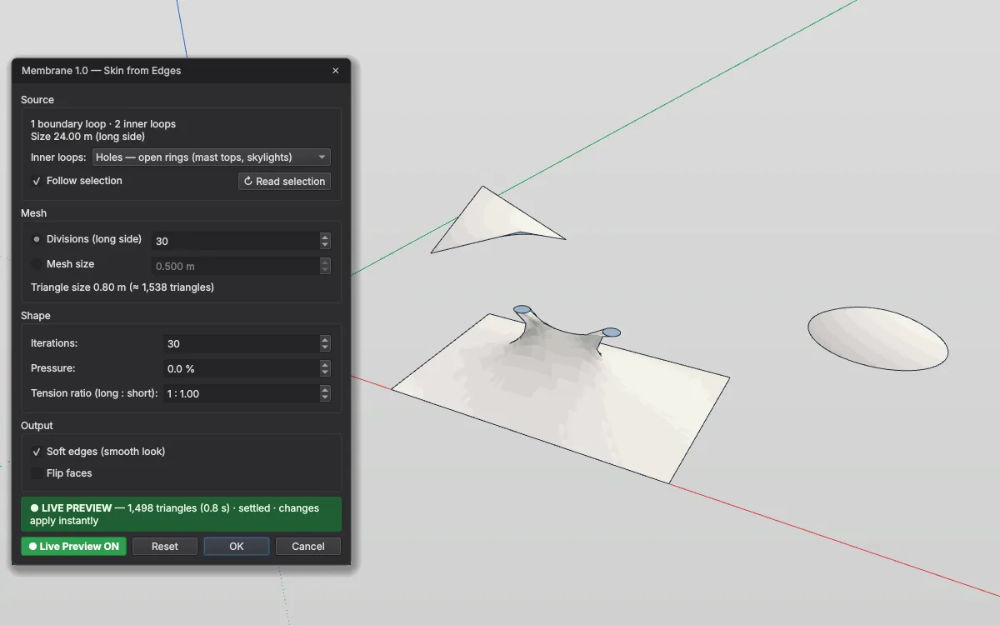

# Membrane — Membranflächen für IngeTrazo

Spannt eine **Minimalfläche** (die Form einer Seifenhaut in einem Drahtrahmen) in eine Schleife aus Kanten — für Zelte, Sonnensegel, Überdachungen, Kissen und Formfindungsstudien.

[English → README.md](README.md)

## Installation
1. In IngeTrazo: **Extensions ▸ Open plugins folder** (Windows: `%APPDATA%\ingetrazo\plugins\`, Linux: `~/.local/share/ingetrazo/plugins/`).
2. `membrane_tool.py` in diesen Ordner kopieren.
3. IngeTrazo neu starten → **Extensions ▸ Membrane ▸** *Skin from Edges… · Edit Membrane…* (auch im Rechtsklick-Menü).

Benötigt IngeTrazo ≥ 0.5 (Extension-API 2).

## Bedienung
Eine **geschlossene Kantenschleife** auswählen (lose Kanten und/oder eine Gruppe aus Kanten) und **Skin from Edges…** starten. Die Schleife darf räumlich gebogen sein (Sattel, Hypar, Wellenrand).

- **Innere geschlossene Schleifen** — Mastringe / Oberlichter (*Holes*) oder *Fixed lines*, über die die Haut weiterläuft. **Offene Kantenzüge** innen sind feste Linien (Grat- oder Kehlseile); gewählte **Hilfspunkte** (Tape Measure) sind feste Punkte (Mastspitzen, Tiefpunkte).
- **Pressure** (−100 … 100 %) bläht die Haut nach außen oder saugt sie ein; 100 % ist eine Halbkugel über einem Kreis.
- **Tension ratio** (lang : kurz) macht die Haut in einer Richtung steifer (Kette : Schuss).
- **Divisions / Mesh size**, **Iterations** (die Statuszeile zeigt *settled*, wenn sich die Form nicht mehr bewegt), **Soft edges**, **Flip faces**.
- **Live Preview** baut die Haut im Modell, während der Dialog offen bleibt (Orbit, Pan, Zoom); **OK** übernimmt die aktuelle Vorschau ohne Neuberechnung. **Follow selection** übernimmt eine neue Auswahl bei offenem Dialog.
- Das Ergebnis ist eine Gruppe, die Quelle und Einstellungen kennt: auswählen und **Edit Membrane…** starten, um alles zu ändern. Ein Undo-Schritt.

## Beispieldatei
[`examples/membrane_examples.igz`](examples/membrane_examples.igz) — Rahmen zum Ausprobieren, nebeneinander ab Nullpunkt: Hypar, Zelt mit zwei Masten, Druckkissen, Gratseil, Wellenrand, Punktzelt (+ Hilfspunkt).

## Änderungen
- **1.1** — eigene Werkzeugleiste **Membrane** mit einem Icon je Befehl (Skin from Edges… · Edit Membrane…). Sie erscheint in einer eigenen Zeile unter den eingebauten Leisten und lässt sich wie diese verschieben, abdocken oder ausblenden (Rechtsklick auf eine Leiste). Icons im Stil von IngeTrazo, passend zum hellen/dunklen Theme.
- **1.0** — erste Veröffentlichung.

## Lizenz
GPL-3.0-or-later · © 2026 Pesi (pesi3d.de) · [Impressum](https://pesi3d.de)
